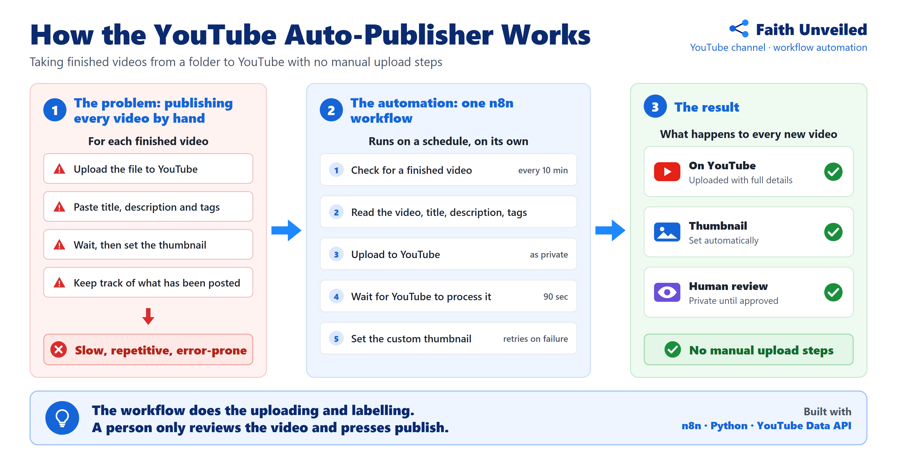
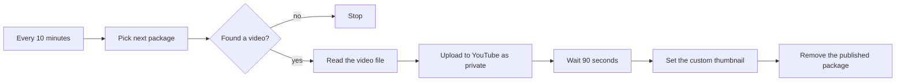
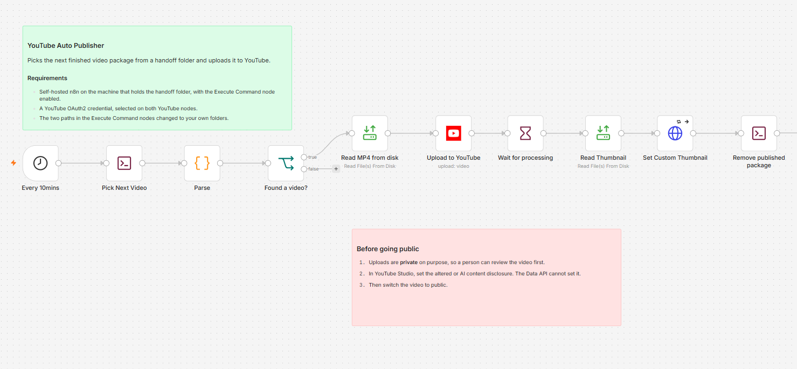
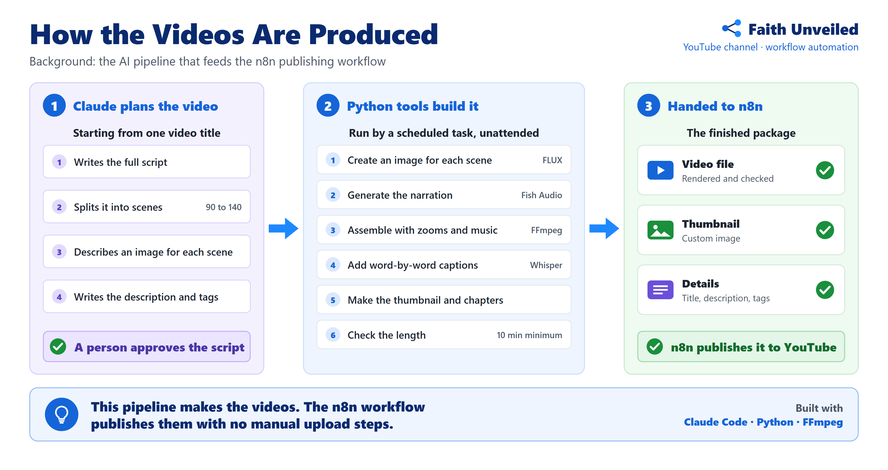

# YouTube Auto Publisher (n8n)

An n8n workflow that takes finished videos from a folder and uploads them to YouTube with no manual upload steps.

It was built for Faith Unveiled, a YouTube channel publishing long-form videos. The same publishing design runs four channels.



## The problem

Every finished video needed the same manual routine: upload the file, paste the title, description and tags, wait, then set the thumbnail. It is slow, repetitive and easy to get wrong.

## How it works



The workflow on the n8n canvas:



1. A schedule trigger runs the workflow every 10 minutes.
2. A small Python script looks in a handoff folder for a finished video package.
3. If there is one, n8n reads the video and uploads it to YouTube as private, with its title, description and tags.
4. It waits 90 seconds for YouTube to process the video.
5. It sets the custom thumbnail through the YouTube Data API.
6. A second script removes the package from the handoff folder.

A person then reviews the video in YouTube Studio and presses publish.

## Design choices

- **Only complete packages are picked up.** A package is a video, a thumbnail and a details file. The details file is written last, so a video that is still being copied is never uploaded.
- **Private by default.** Nothing goes public without a person reviewing it first.
- **A thumbnail failure never blocks the upload.** The thumbnail step retries three times, 30 seconds apart. If it still fails, the workflow carries on.
- **No double uploads.** The package is removed after the upload, so the next run cannot pick it up again.

## What is in this folder

| Path | What it is |
|---|---|
| `workflow.json` | The n8n workflow, ready to import |
| `scripts/pick_next.py` | Finds the next finished package and prints its details as JSON |
| `scripts/mark_done.py` | Removes a package after it has been uploaded |
| `example-package/` | An example details file showing the package format |
| `images/` | The diagrams used on this page |

## Package format

Three files that share a name, placed in the handoff folder:

```
my-first-video.mp4    the video
my-first-video.png    the thumbnail (optional)
my-first-video.json   the details, written last
```

See [`example-package/my-first-video.json`](example-package/my-first-video.json) for the details file.

## Setup

1. Run n8n on the machine that holds the handoff folder. The workflow uses the Execute Command node, which n8n 2.x turns off by default. Start n8n with `NODES_EXCLUDE=[]` to turn it on, and add the handoff folder to `N8N_RESTRICT_FILE_ACCESS_TO` so n8n can read the video.
2. Import `workflow.json` into n8n.
3. Create a YouTube OAuth2 credential in n8n and select it on the two YouTube nodes.
4. In the two Execute Command nodes, change the two example paths to this folder and to your handoff folder.
5. Put a package in the handoff folder and turn the workflow on.

## Background: where the videos come from

The workflow publishes videos that are made by a separate AI pipeline.



Claude (Anthropic's AI model, run through Claude Code) takes a title, writes the script and splits it into roughly 90 to 140 scenes. Python tools then build the video: an AI image model (FLUX) creates a picture for each scene, Fish Audio generates the narration, and FFmpeg assembles it with slow zooms, word-by-word captions and background music. The same run produces the thumbnail, description, chapters and tags, and a scheduled task renders videos unattended before handing them to the n8n workflow.
